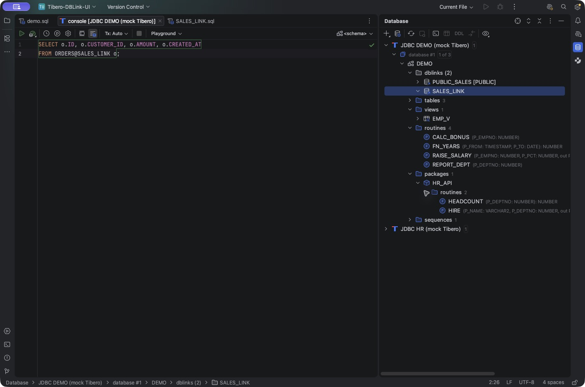

# Tibero Database Tools

Tibero Database Tools는 IntelliJ IDEA의 Database Tools에서 Tibero를 편리하게 사용하기 위한
오픈소스 플러그인입니다. 익숙한 Database 도구 창과 SQL 콘솔에서 DB 링크와 원격 객체를 탐색하고,
저장 객체의 소스를 확인하며 실행 계획을 분석할 수 있습니다.

**지원 환경:** IntelliJ IDEA 2026.1.5~2026.2.x · Database Tools and SQL · Diagrams<br>
**현재 버전:** `0.7.8-rc.1`<br>
**라이선스:** Apache License 2.0

## 주요 기능

| 기능 | 할 수 있는 일 |
|---|---|
| DB 링크 탐색 | 스키마의 `dblinks`에서 private/PUBLIC 링크를 확인하고 생성 DDL을 엽니다. |
| 원격 SQL 자동완성 | 링크 이름과 매핑된 원격 테이블·컬럼을 완성합니다. |
| 정의로 이동 | SQL의 링크 이름과 원격 테이블·컬럼에서 해당 정의로 이동합니다. |
| 저장 객체 탐색 | 프로시저·함수·패키지, 인자·반환 타입 및 뷰 등의 메타데이터를 확인합니다. |
| 소스 보기·편집 | 저장 객체 소스를 열고 편집합니다. IDEA 2026.2에서는 Submit과 연동됩니다. |
| SQL 콘솔 | Oracle SQL/PLSQL dialect, DBMS_OUTPUT, 컴파일 오류 조회, 루틴 실행문 생성을 지원합니다. |
| 실행 계획 | Explain Plan의 트리·표·다이어그램과 Raw 계획, Explain Analyse의 실행 통계를 확인합니다. |
| 메타데이터 보정 | Tibero 6 함수 인자 조회와 TIMESTAMP 등 일부 JDBC 타입 표시를 보정합니다. |

## 설치 및 시작

1. IntelliJ IDEA에서 **Database Tools and SQL**과 **Diagrams**를 활성화합니다.
2. [GitHub Releases](https://github.com/kergosdyr/tibero-database-tools/releases)에서 `0.7.8-rc.1` ZIP 또는 JAR를 받습니다.
3. **Settings → Plugins → ⚙ → Install Plugin from Disk…**에서 파일을 선택하고 IDE를 재시작합니다.
4. Database 도구 창에서 **Tibero 데이터 소스**를 만들거나 기존 연결을 선택합니다.
5. Tibero 드라이버 설정에 서버에 맞는 **JDBC JAR를 별도로 등록**하고 연결을 테스트합니다.
6. 사용할 스키마를 선택한 뒤 **Refresh**하여 객체 정보를 가져옵니다.

이제 Database 도구 창에서 객체를 살펴보거나 Tibero 데이터 소스에 연결된 SQL 콘솔에서
쿼리를 작성할 수 있습니다.

## 원격 DB 링크 자동완성

DB 링크 이름은 로컬 스키마에서 수집합니다. 원격 테이블·컬럼까지 자동완성하려면
링크가 가리키는 데이터베이스를 IDE에 별도 데이터 소스로 연결하고 매핑합니다.

1. 로컬 Tibero 스키마를 **Refresh**하여 `dblinks` 목록을 확인합니다.
2. 실제 링크 대상과 같은 원격 데이터 소스를 등록하고 필요한 스키마를 **Refresh**합니다.
3. 링크를 선택한 뒤 **Map DB Link for Completion…**을 실행합니다.
4. **DB Link Completion**에서 원격 데이터 소스를 선택해 **OK**, 이어서 기본 스키마를 선택해 **OK**를 누릅니다.

로컬 Tibero SQL 콘솔에서 다음과 같이 작성할 수 있습니다.

```sql
SELECT o.ID, o.AMOUNT, o.CREATED_AT
FROM ORDERS@SALES_LINK o;
```

자동완성은 기본 키맵의 **Ctrl+Space**(사용 중인 키맵에 따라 다름)로 호출합니다.
원하는 항목을 선택한 뒤 **Enter**로 입력합니다.
링크 매핑은 IDE 재시작 후에도 유지되며, 원격 객체가 변경되면 해당 데이터 소스를
Refresh하면 됩니다.



*DB 링크 및 원격 객체를 탐색하는 SQL 콘솔. Mock JDBC 데모 환경에서 촬영했습니다.*

## 문서

- [사용 가이드](docs/USAGE.ko.md) — 연결, 링크 매핑, 자동완성, 소스와 실행 계획
- [개발 가이드](docs/DEVELOPMENT.md) — 빌드 및 테스트
- [변경 기록](CHANGELOG.md) — 버전별 변경 사항

## 라이선스

[Apache License 2.0](LICENSE)에 따라 공개됩니다.
저작권 및 고지 사항은 [NOTICE](NOTICE)를 참고하세요.
