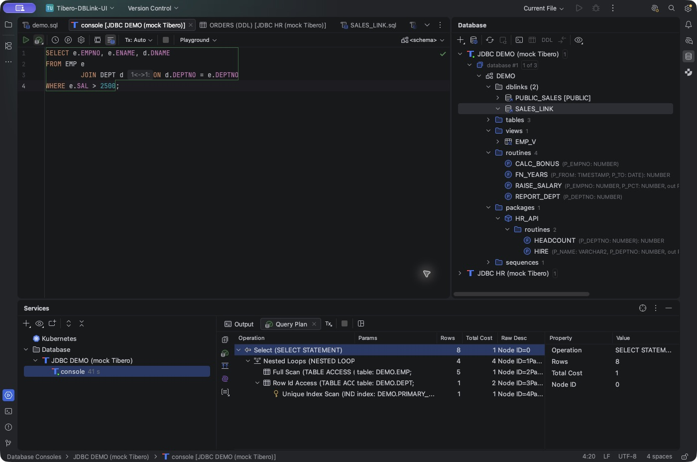
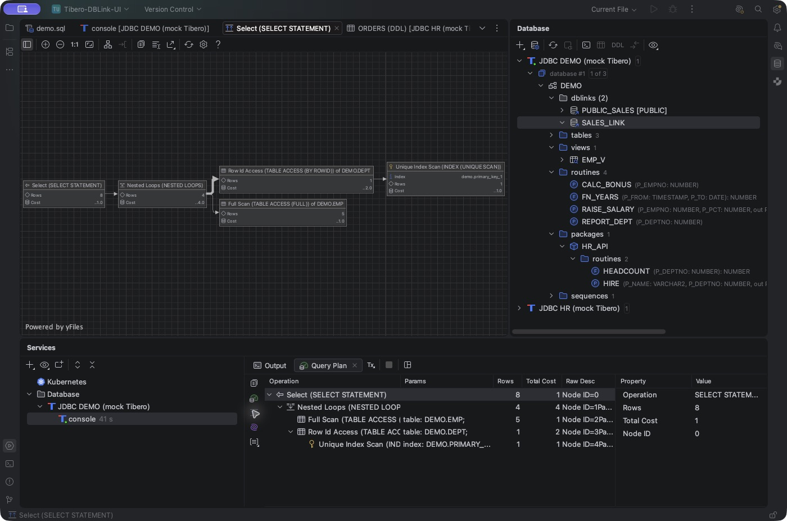
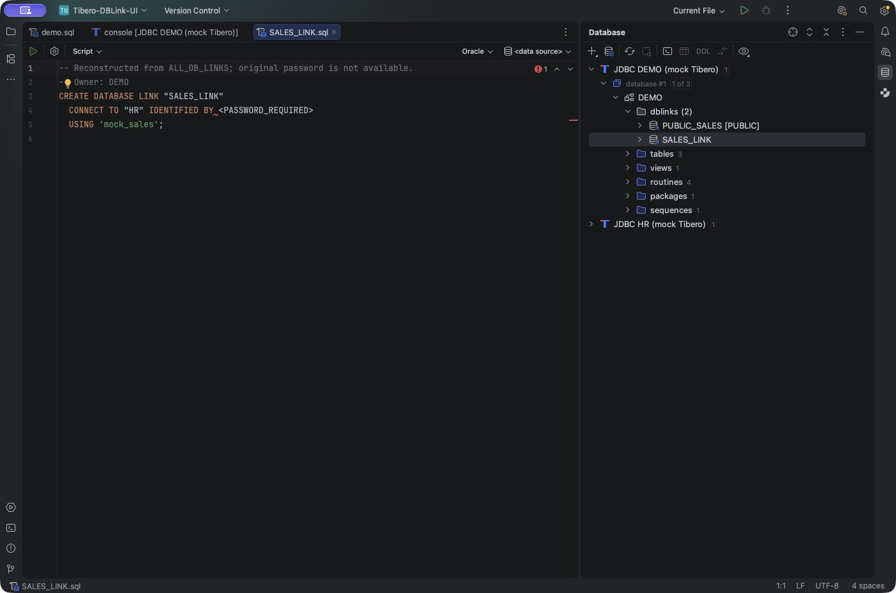

# Tibero Database Tools

**IntelliJ IDEA에서 Tibero 데이터베이스를 더 편리하게 사용할 수 있도록 Database Tools를 확장하는 무료 오픈소스 플러그인입니다.**

익숙한 Database 도구 창과 SQL 콘솔에서 프로시저와 패키지를 탐색하고, PL/SQL을 작성·실행하며, 쿼리 실행 계획을 분석할 수 있습니다. DB 링크를 통한 원격 테이블·컬럼 자동완성과 다양한 카탈로그 조회 기능도 제공하여 데이터베이스 개발과 분석에 필요한 작업을 IDE 안에서 이어갈 수 있습니다.


*Database 도구 창의 패키지·루틴·DB 링크 탐색과 SQL 콘솔 작업 화면.*

## 주요 기능

### 1. 데이터베이스 객체 탐색과 자동완성

Tibero의 프로시저, 함수, 패키지, 패키지 멤버, 시퀀스 등 다양한 객체를 IDE에서 탐색할 수 있습니다.

특히 패키지와 저장 루틴의 메타데이터를 보충하여 SQL 작성 시 활용할 수 있습니다.

- 프로시저·함수의 인자와 반환 타입 확인
- `IN`, `OUT`, `IN OUT` 인자 정보 제공
- 오버로드된 루틴의 시그니처 구분
- 패키지 멤버 자동완성 시 인자 목록과 반환 타입 표시

패키지 내부의 함수를 호출하거나 인자가 많은 프로시저를 사용할 때 필요한 정보를 SQL 에디터에서 바로 확인할 수 있습니다.

### 2. 저장 객체 소스 보기와 편집

프로시저, 함수, 패키지 명세·본문, 뷰의 소스를 열어 확인하고 편집할 수 있습니다.

IntelliJ IDEA 2026.2에서는 `CREATE OR REPLACE` 기반 소스 편집과 **Submit** 기능이 통합되어 수정한 내용을 해당 데이터 소스에 반영할 수 있습니다.

Submit은 데이터베이스에서 DDL을 실제 실행하는 동작이므로 변경할 객체와 연결 정보를 확인하고 사용하세요.

### 3. PL/SQL 실행과 개발 지원

저장 루틴을 실행하거나 디버깅에 필요한 정보를 확인하는 작업도 SQL 콘솔에서 처리할 수 있습니다.

- **Execute Routine:** 객체의 <strong>Tibero → Execute Routine…</strong>으로 인자, OUT 변수, 함수 반환값을 고려한 PL/SQL 실행 블록 생성
- **DBMS_OUTPUT:** SQL 콘솔의 토글을 통해 PL/SQL에서 출력한 메시지 수집
- **컴파일 오류:** `CREATE OR REPLACE` 실행 후 `ALL_ERRORS`에서 오류의 행·열·메시지를 조회해 콘솔에 표시

Execute Routine은 편집 가능한 실행 블록을 새 콘솔에 준비합니다. 입력 인자값을 채운 뒤 실행하면 됩니다.

### 4. 실행 계획 분석

Tibero SQL의 접근 방식과 실행 비용을 IDE의 실행 계획 화면에서 살펴볼 수 있습니다.

**Explain Plan**

- IDE 기본 실행 계획 뷰의 트리·표·다이어그램 활용
- 실행 단계별 대상 객체, 비용, 예상 행 수 확인
- `ACCESS`, `FILTER` 조건 확인
- Raw 실행 계획 조회

**Explain Analyse**

- `SELECT`/`WITH` 쿼리를 실제 실행하고 결과를 끝까지 fetch
- 실제 행 수, 실행 시간, Starts, Buffer Gets 통계 확인
- 예상 계획과 실제 실행 정보를 함께 살펴보며 쿼리 동작 분석

실행 비용이 큰 쿼리는 Explain Analyse 사용 시 데이터베이스 부하를 고려하세요.





### 5. DB 링크 탐색과 원격 SQL 자동완성

스키마의 `dblinks`에서 private 및 PUBLIC DB 링크를 탐색하고, 링크를 더블클릭하거나 Enter를 눌러 생성 DDL을 열 수 있습니다. SQL의 `@링크명`에서 정의로 이동하는 기능도 제공합니다.

DB 링크에 원격 데이터 소스를 매핑하면 원격 테이블과 컬럼을 SQL에서 자동완성하고 해당 객체의 정의로 이동할 수 있습니다.

```sql
SELECT o.ID, o.AMOUNT, o.CREATED_AT
FROM ORDERS@SALES_LINK o;
```

원격 자동완성에는 실제 링크 대상과 같은 데이터베이스를 별도 IDE 데이터 소스로 등록하고, 스키마를 Refresh한 뒤 링크별로 매핑하는 과정이 필요합니다. 링크 목록과 매핑은 IDE 재시작 후에도 유지됩니다.

설정 방법은 [사용 가이드의 DB 링크 매핑](docs/USAGE.ko.md#4-원격-데이터-소스-매핑하기)을 참고하세요.



*Database 도구 창에서 DB 링크의 생성 DDL 열기.*

### 6. 카탈로그 조회 바로가기

Database 도구 창에서 스키마나 객체를 우클릭하면 <strong>Tibero</strong> 메뉴를 통해 필요한 카탈로그 조회 SQL을 새 콘솔에 준비할 수 있습니다.

객체 정의부터 의존 관계와 권한까지 상황에 맞는 조회 SQL을 빠르게 작성할 수 있습니다.

| 조회 대상 | 메뉴 |
|---|---|
| 스키마 객체 | `Schema Stored Objects`, `Schema Synonyms`, `Schema Sequences` |
| 객체 정의와 메타데이터 | `View Definition`, `Column Types`, `Routine Arguments`, `Object Source`, `Package Body` |
| 오류와 의존 관계 | `Compilation Errors`, `Dependencies`, `Dependent Objects` |
| 트리거와 권한 | `Table Triggers`, `Object Privileges` |

선택한 스키마나 객체에 맞는 SQL이 새 콘솔에 준비되므로 내용을 확인하고 필요한 조회를 실행할 수 있습니다.

### 7. Tibero SQL과 JDBC 메타데이터 보정

Tibero의 SQL 및 JDBC 메타데이터 특성을 IDE에 반영하여 객체 참조와 타입 정보를 더 편리하게 사용할 수 있습니다.

- 기본 GenericSQL 연결에 Oracle SQL/PLSQL dialect 적용
- 현재 스키마 및 PUBLIC 시노님을 통한 SQL 참조 해석
- Tibero 6 함수 인자 메타데이터 조회 보정
- TIMESTAMP 등 일부 JDBC 타입 표시 보정

패키지 멤버, 함수 인자, 시노님을 참조하는 SQL에서 IDE의 자동완성과 탐색 기능을 활용할 수 있습니다.

## 설치 및 시작

**지원 IDE:** IntelliJ IDEA 2026.1.5 ~ 2026.2.x<br>
**현재 버전:** `0.7.8-rc.1`

1. IntelliJ IDEA에서 **Database Tools and SQL**과 **Diagrams**를 활성화합니다.
2. [GitHub Releases](https://github.com/kergosdyr/tibero-database-tools/releases)에서 설치용 ZIP 또는 JAR를 다운로드합니다.
3. <strong>Settings → Plugins → ⚙ → Install Plugin from Disk…</strong>에서 파일을 선택합니다.
4. IDE를 재시작한 뒤 Database 도구 창에서 Tibero 데이터 소스를 설정합니다.
5. 서버에 맞는 **Tibero JDBC 드라이버 JAR**를 별도로 등록하고 연결을 테스트합니다.
6. 사용할 스키마를 선택하여 **Refresh**하면 객체 탐색과 SQL 콘솔 기능을 사용할 수 있습니다.

SQL 콘솔의 기본 자동완성은 `Ctrl+Space`로 호출할 수 있으며, 단축키는 IDE 키맵에 따라 달라질 수 있습니다.

## 문서

- [사용 가이드](docs/USAGE.ko.md) — 데이터 소스 연결, 원격 DB 링크 매핑, SQL 자동완성, 객체 소스와 실행 계획
- [개발 가이드](docs/DEVELOPMENT.md) — 빌드, 테스트 및 IDE 호환성
- [변경 기록](CHANGELOG.md) — 버전별 변경 사항

## 라이선스

Tibero Database Tools는 [Apache License 2.0](LICENSE)에 따라 공개됩니다.

자세한 내용은 [LICENSE](LICENSE)와 [NOTICE](NOTICE)를 참고하세요.
