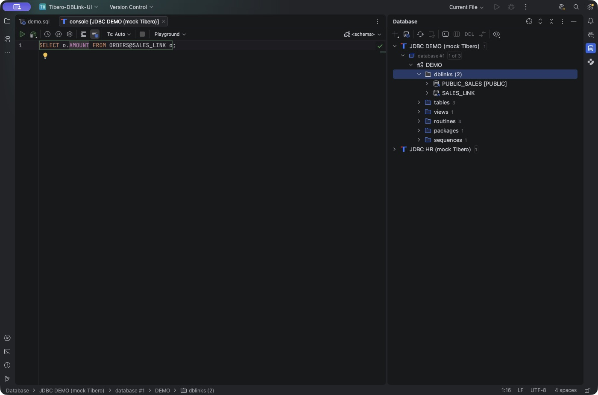

# Tibero Database Tools

IntelliJ IDEA의 기본 Database Tools에 Tibero 객체 탐색, DB 링크 자동완성·DDL 이동, 실행 계획을 추가하는 무료 오픈소스 플러그인입니다. Pinpoint와 독립적으로 빌드·설치합니다.

**현재 버전: 0.7.8-rc.1 — 출시 후보.** 실제 Tibero 6/7 서버 검증이 남아 있습니다. Marketplace 정식 배포는 아직 하지 않았습니다.

## 설치

1. IntelliJ IDEA의 **Database Tools and SQL**, **Diagrams**를 활성화합니다. 해당 기능을 사용할 수 있는 IDE 환경이 필요합니다.
2. [Releases](https://github.com/kergosdyr/tibero-database-tools/releases)의 ZIP 또는 JAR를 내려받습니다.
3. **Settings → Plugins → ⚙ → Install Plugin from Disk…**에서 파일을 선택하고 재시작합니다.
4. IDE의 **Tibero** 드라이버 정의에 서버와 맞는 JDBC JAR를 직접 등록합니다. 이 플러그인 JAR는 JDBC 드라이버가 아닙니다.
5. 연결을 테스트하고 사용할 스키마를 선택해 **Refresh**합니다.

설치 범위는 IDEA **2026.1.5(build 261.27258.48)–2026.2.x**입니다. 현재 확인한 빌드는 261.27258.48과 262.10968.63입니다. 이전 IDEA, DataGrip, 모든 중간 패치를 검증한 것으로 간주하지 않습니다.

## 제공 기능

| 기능 | 동작·조건 |
|---|---|
| DB 링크 트리 | 스키마 아래 `dblinks`에 private/PUBLIC 링크와 개수 표시 |
| DB 링크 DDL | 링크 더블클릭·Enter·Jump to Source, SQL 링크명 정의 이동 |
| 링크 자동완성 | `ORDERS@SA…`에서 저장된 링크명 제안 |
| 원격 테이블·컬럼 | 명시적으로 매핑한 데이터 소스의 수집된 모델 사용 |
| 원격 정의 이동 | 매핑한 원격 테이블·컬럼으로 이동 |
| 재시작 복원 | 링크 목록·매핑은 IDE 설정, 원격 모델은 IDE 메타데이터 저장소에서 복원 |
| 저장 객체 | 함수·프로시저·패키지·인자·반환형을 카탈로그로 보충 |
| 객체 소스 | 프로시저·함수·패키지·뷰 소스 열기; Submit 통합은 262에서 제공 |
| 실행 계획 | 기본 Explain Plan 트리·표·다이어그램, Raw 계획 |
| 실제 실행 계획 | Explain Analyse로 SELECT/WITH 실행·전체 fetch 후 실제 통계 표시 |
| 콘솔 | Oracle SQL/PLSQL dialect, DBMS_OUTPUT, 컴파일 오류 조회, 루틴 실행문 생성 |
| JDBC 보정 | Tibero 6 함수 인자 조회 결함 우회, TIMESTAMP 등 타입 표시 보정 |

## DB 링크 자동완성 설정

**원격 테이블·컬럼은 링크마다 원격 데이터 소스와 기본 스키마를 한 번 지정해야 합니다.** 링크를 통한 원격 모델 자동 수집은 제공하지 않습니다.

1. 로컬 Tibero 스키마를 새로고침해 `dblinks` 목록을 수집합니다.
2. 원격 DB를 별도 IDE 데이터 소스로 등록하고 사용할 원격 스키마를 새로고침합니다.
3. `dblinks` 아래 링크를 선택합니다.
4. **Find Action → Map DB Link for Completion…** 또는 해당 우클릭 메뉴를 엽니다.
5. 원격 데이터 소스와 기본 스키마를 지정합니다.
6. 로컬 Tibero 데이터 소스에 연결된 SQL 콘솔에서 완성을 호출합니다.

```sql
-- |는 커서 위치이며 입력하는 문자가 아닙니다.
SELECT * FROM ORDERS@SA|;
SELECT * FROM OR|@SALES_LINK;
SELECT o.| FROM ORDERS@SALES_LINK o;
SELECT o.AMOUNT FROM ORDERS@SALES_LINK o;
```

마지막 문장에서 테이블·컬럼·링크가 각각 해석됩니다. 타이핑할 때 네트워크 쿼리는 실행하지 않습니다. 원격 스키마의 변경은 원격 데이터 소스 Refresh로 반영합니다.

DDL은 `ALL_DB_LINKS`로 재구성합니다. 원래 생성문과 비밀번호를 복원하지 않습니다. `<PASSWORD_REQUIRED>`는 사용자가 실제 값으로 바꿔야 하는 자리이며, 그대로는 유효한 실행문이 아닙니다. DDL을 자동 실행하지 않습니다.



화면은 IDEA 2026.2.3의 실제 SQL 콘솔입니다. 테스트용 Mock JDBC 서버에서 메타데이터를 수집한 뒤 IDE를 재시작했습니다. 실제 Tibero 서버 접속 화면은 아닙니다.

자세한 사용법과 문제 구분은 [사용 가이드](docs/USAGE.ko.md)를 참고합니다.

## 확인한 범위와 제한

- 실제 IDE 261/262의 SQL PSI, 네이티브 트리, 소스 편집, 계획 모델 및 디스크 저장 회귀 검사를 실행합니다.
- IDEA 262 UI에서 Mock JDBC 연결·Refresh·콘솔 조회·원격 매핑·완성 선택/삽입·SQL 정의 이동·트리 더블클릭·재시작 복원을 직접 검사했습니다.
- **실제 Tibero 6/7 서버와 Tibero 7 JDBC 드라이버는 미검증**입니다. Mock 서버는 DB 링크 SQL을 원격 실행하는 서버가 아닙니다.
- 원격 소스 연결 없이 링크만으로 원격 테이블·컬럼을 수집하는 기능, DB 링크 생성/변경 UI, PL/SQL 디버거, Oracle 전체 모델 호환은 제공하지 않습니다.
- SYS 패키지 등 수집하지 않은 객체와 일부 기본 인자 검사는 IDE에서 미해결 참조/경고로 표시될 수 있습니다. 모든 Oracle SQL 분석 기능을 보장하지 않습니다.
- Database Tools 내부·실험 API를 사용합니다. 공식 Plugin Verifier의 바이너리 호환 결과와 실제 동작 검사를 함께 확인하며, IDE 신규 버전마다 재검증해야 합니다.

추가 기능 확장보다 실서버 검증과 호환성 유지가 첫 출시의 우선 조건입니다. 공개 API·트리 모델 전체를 새로 만드는 작업은 이번 출시 범위에 포함하지 않습니다.

## 개발·출시

- [빌드와 검증](docs/DEVELOPMENT.md)
- [변경 기록](CHANGELOG.md)
- [출시 준비와 남은 조건](docs/RELEASING.md)
- [Marketplace 소개 초안](docs/MARKETPLACE.md)

Apache License 2.0. [LICENSE](LICENSE)와 [NOTICE](NOTICE)를 참고하세요. TmaxTibero·JetBrains와 제휴한 제품이 아니며, JDBC 드라이버·IDE 바이너리를 배포물에 포함하지 않습니다.
