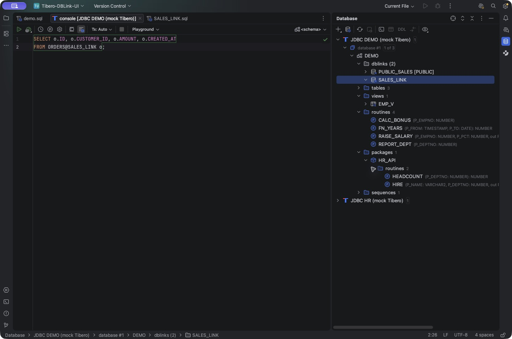
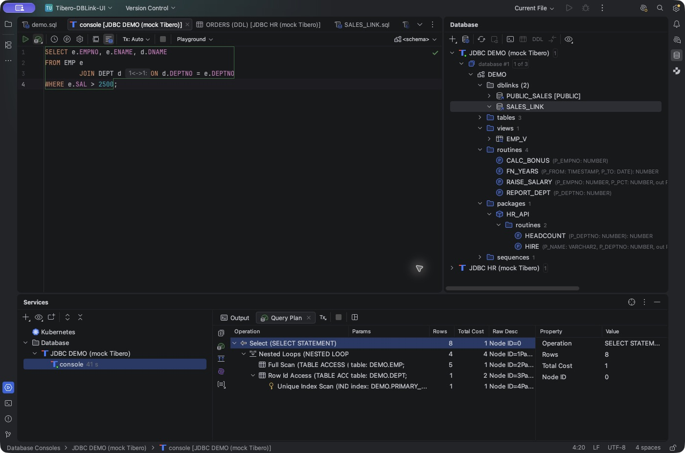
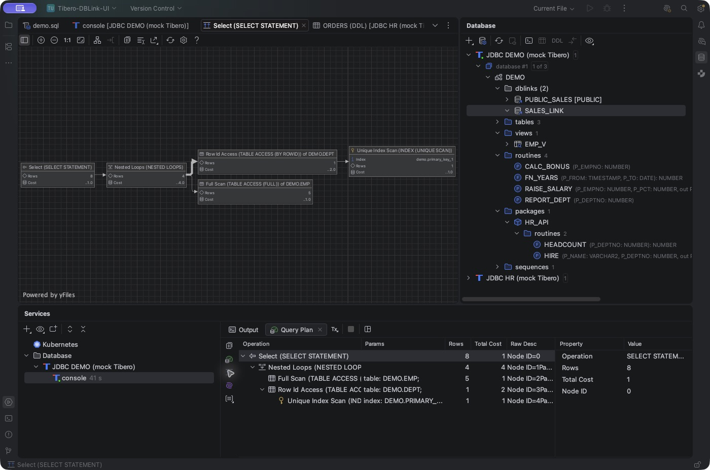

# Tibero Database Tools

**Vendor:** kergosdyr 
**Price:** Free 
**License:** Apache License 2.0 
**Source:** https://github.com/kergosdyr/tibero-database-tools

## Overview

Tibero Database Tools brings Tibero-specific database development features to IntelliJ IDEA's built-in Database Tools.

Explore stored procedures and packages, work with PL/SQL, inspect execution plans, and write SQL with database link and remote object completion. The plugin integrates with the familiar Database tool window, SQL consoles, source editors, and execution plan views.

## Features

### Database Objects and Code Completion

Browse stored procedures, functions, packages, package members, and sequences.

Inspect routine parameters, `IN`, `OUT`, and `IN OUT` modes, return types, and overloaded signatures. Package member completion displays parameter lists and return types to help you select the appropriate routine while writing SQL.

### Stored Object Sources

Open and edit procedure, function, package specification, package body, and view sources.

IntelliJ IDEA 2026.2 provides `CREATE OR REPLACE` source editing with Submit integration. Submit executes the DDL against the selected data source.

### PL/SQL Development Tools

Use **Tibero → Execute Routine…** to generate an editable PL/SQL execution block in a new console, including input parameters, OUT variables, and function return values.

Additional tools include:

- **DBMS_OUTPUT:** Collect PL/SQL output through a SQL console toggle.
- **Compilation errors:** Display line, column, and error messages from `ALL_ERRORS` after `CREATE OR REPLACE`.

### Execution Plan Analysis

Inspect estimated execution plans using the IDE's native tree, table, and diagram views.

Examine accessed objects, estimated costs and row counts, and ACCESS/FILTER predicates. Raw execution plans are also available.

**Explain Analyse** executes a SELECT/WITH query, fetches all results, and associates execution statistics including actual rows, execution time, Starts, and Buffer Gets with the plan.

### Database Links and Remote SQL

Browse private and PUBLIC database links, open reconstructed creation DDL, and navigate from SQL link references to their definitions.

Complete database link names, remote tables, and columns using explicitly mapped remote data sources and schemas. Remote object navigation and completion use metadata collected by the IDE. Link catalogues and mappings persist across restarts.

For remote completion, register and refresh the actual link target as a separate data source, then map the link to that source and its default schema.

### Catalogue Query Shortcuts

Right-click a schema or object and open the **Tibero** menu to prepare catalogue queries in a new SQL console.

Available actions cover stored objects, view definitions, column types, routine arguments, source code, package bodies, compilation errors, dependencies, dependent objects, table triggers, schema synonyms, sequences, and object privileges.

### SQL and JDBC Integration

Use Oracle SQL/PLSQL dialect integration, current-schema and PUBLIC synonym resolution, Tibero 6 function-argument metadata corrections, and improved display of selected JDBC types, including TIMESTAMP types.

## Getting Started

1. Download the plugin ZIP or JAR from [GitHub Releases](https://github.com/kergosdyr/tibero-database-tools/releases).
2. Install it using **Settings → Plugins → Install Plugin from Disk…** and restart IntelliJ IDEA.
3. Register your Tibero JDBC driver, connect to the database, and refresh the required schemas.
4. Open the Database tool window or a SQL console to begin working.

See the [User Guide](https://github.com/kergosdyr/tibero-database-tools/blob/main/docs/USAGE.ko.md) for detailed setup and feature instructions.

## Requirements

- IntelliJ IDEA 2026.1.5–2026.2.x
- Database Tools and SQL
- Diagrams
- Tibero JDBC driver JAR

## Open Source

Tibero Database Tools is available under the **Apache License 2.0**.

Explore the source, documentation, releases, and issues on [GitHub](https://github.com/kergosdyr/tibero-database-tools).
