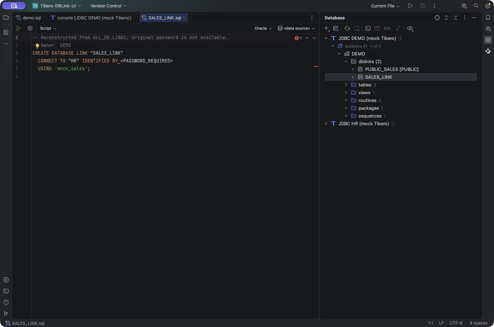
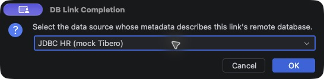
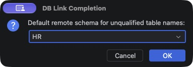
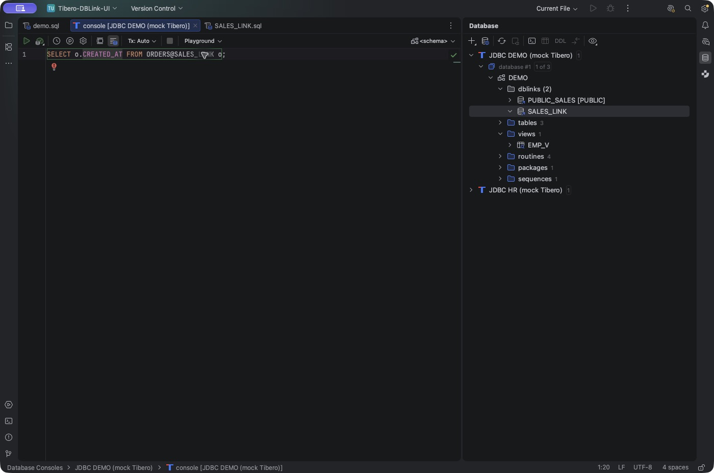
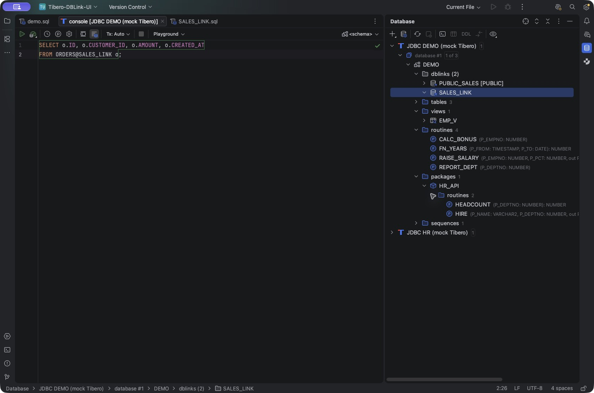

# Tibero Database Tools 사용 가이드

IntelliJ IDEA에서 Tibero 연결을 설정한 뒤 객체를 탐색하고, DB 링크를 매핑해 원격 SQL 자동완성을 사용하는 방법을 설명합니다. 마지막에는 저장 객체, SQL 콘솔, 실행 계획 기능을 살펴봅니다.

## 1. Tibero 연결하기

1. IntelliJ IDEA에서 **Database** 도구 창을 엽니다.
2. Tibero 데이터 소스를 추가하거나 기존 Tibero 연결을 선택합니다.
3. 드라이버 설정에 서버에 맞는 **Tibero JDBC JAR**를 등록합니다.
4. 접속 정보 입력 후 **Test Connection**으로 연결을 확인합니다.
5. 사용할 스키마와 객체 필터를 선택합니다.
6. **Refresh**하여 데이터베이스 메타데이터를 가져옵니다.

플러그인은 IDE에서 Tibero로 인식하는 데이터 소스에 적용됩니다. Generic 드라이버의 이름만 변경한 연결에서는 일부 기능이 연결되지 않을 수 있습니다.

기본 dialect가 GenericSQL인 Tibero 연결은 시작 시 Oracle SQL dialect로 보정됩니다. 사용자가 직접 지정한 dialect는 유지됩니다.

객체가 보이지 않으면 선택한 스키마, 객체 필터, 계정의 카탈로그 조회 권한을 확인하세요. 객체가 변경되었다면 해당 데이터 소스를 다시 **Refresh**합니다.

## 2. 객체 탐색하기

Database 도구 창에서 테이블·뷰·시퀀스와 저장 객체를 살펴볼 수 있습니다. 프로시저, 함수, 패키지에 대해서는 카탈로그에서 인자·반환 타입 및 패키지 멤버 정보를 보충합니다.

1. 필요한 스키마를 펼칩니다.
2. 프로시저, 함수 또는 패키지를 선택합니다.
3. 객체와 멤버의 인자·반환 타입을 확인합니다.
4. 소스를 확인하려면 해당 객체의 소스 열기 동작을 사용합니다.

Tibero 6 함수 인자 조회와 TIMESTAMP 등 일부 JDBC 타입 표시에도 보정이 적용됩니다.

## 3. DB 링크와 생성 DDL 확인하기

로컬 Tibero 스키마를 **Refresh**하면 스키마 아래 `dblinks` 그룹에서 private 및 PUBLIC DB 링크를 볼 수 있습니다. 같은 이름의 링크가 있으면 현재 스키마의 private 링크가 우선합니다.

링크 생성 DDL을 여는 방법은 다음과 같습니다.

1. `dblinks`를 펼쳐 원하는 링크를 찾습니다.
2. 링크 이름을 **더블클릭**하거나 선택 후 **Enter**를 누릅니다.
3. 또는 **Jump to Source**를 사용합니다.
4. SQL 콘솔에서 `@SALES_LINK`의 링크 이름에 **정의로 이동**을 실행해도 같은 DDL을 열 수 있습니다.



*DB 링크에서 재구성된 생성 DDL을 연 화면.*

DDL은 `ALL_DB_LINKS`의 카탈로그 정보로 재구성합니다. 비밀번호 자리의 `<PASSWORD_REQUIRED>`를 실제 비밀번호로 교체한 뒤 실행하세요.

## 4. 원격 데이터 소스 매핑하기

DB 링크 이름 자동완성은 로컬 링크 목록을 사용합니다. 링크를 통해 참조하는 **원격 테이블과 컬럼**까지 완성하려면 원격 데이터 소스를 매핑해야 합니다.

예를 들어 로컬 `DEMO` 스키마의 `SALES_LINK`가 원격 데이터베이스의 `HR` 스키마를 가리킨다고 가정하겠습니다.

### 4.1. 로컬·원격 메타데이터 준비

1. 로컬 Tibero 데이터 소스의 `DEMO` 스키마를 **Refresh**하여 `SALES_LINK`를 확인합니다.
2. 실제 `SALES_LINK` 대상과 같은 데이터베이스를 **별도 데이터 소스**로 등록합니다.
3. 원격 데이터 소스에서 `HR` 스키마를 선택하고 **Refresh**합니다.
4. 원격 데이터 소스의 `ORDERS` 테이블과 컬럼이 IDE에 수집되었는지 확인합니다.

원격 자동완성은 IDE에 수집된 메타데이터를 활용합니다. 따라서 SQL 작성 중 매번 원격 테이블 정보를 조회하지 않습니다.

### 4.2. DB 링크에 원격 소스와 스키마 지정

1. 로컬 데이터 소스의 `dblinks`에서 `SALES_LINK`를 선택합니다.
2. 우클릭 메뉴 또는 **Find Action**에서 <strong>Map DB Link for Completion…</strong>을 실행합니다.
3. 첫 번째 **DB Link Completion** 대화상자에서 **JDBC HR (mock Tibero)**를 선택하고 **OK**를 누릅니다.
4. 다음 대화상자에서 기본 스키마 **HR**을 선택하고 **OK**를 누릅니다.



*첫 번째 단계: DB 링크 대상 데이터 소스 선택.*



*두 번째 단계: 자동완성에 사용할 기본 스키마 선택.*

위 화면은 Mock JDBC 데모 환경을 기준으로 합니다. 실제 사용 환경에서는 DB 링크가 접속하는 원격 데이터 소스를 선택하세요.

## 5. SQL 자동완성 사용하기

로컬 Tibero 데이터 소스에 연결된 SQL 콘솔을 열고 SQL을 작성합니다. 기본 자동완성 호출은 **Ctrl+Space**이며, 사용 중인 키맵에 따라 단축키가 다를 수 있습니다. 제안된 항목을 선택한 뒤 **Enter**로 삽입합니다.

다음 예제에서 `|`는 커서 위치를 나타내며 SQL에 입력하는 문자가 아닙니다.

### DB 링크 이름 완성

```sql
SELECT * FROM ORDERS@SA|;
```

커서에서 자동완성을 호출하고 `SALES_LINK`를 선택한 뒤 **Enter**를 누릅니다.

### 원격 테이블 이름 완성

```sql
SELECT * FROM OR|@SALES_LINK;
```

매핑된 원격 스키마의 `ORDERS`를 선택해 입력합니다.

### 원격 컬럼 완성

```sql
SELECT o.| FROM ORDERS@SALES_LINK o;
```

자동완성에서 `CREATED_AT`을 선택하고 **Enter**를 누르면 다음 SQL이 됩니다.

```sql
SELECT o.CREATED_AT FROM ORDERS@SALES_LINK o;
```



*원격 컬럼 자동완성을 선택해 `CREATED_AT`을 입력한 SQL.*

데모의 `HR.ORDERS` 컬럼은 `ID`, `CUSTOMER_ID`, `AMOUNT`, `CREATED_AT`입니다.



*DB 링크와 원격 객체를 참조하는 SQL 콘솔.*

`HR.ORDERS@SALES_LINK`처럼 원격 스키마를 직접 적으면 해당 스키마를 사용합니다. 스키마를 생략하면 매핑 시 선택한 기본 스키마를 사용합니다.

테이블·컬럼이 변경되면 **원격 데이터 소스**를 Refresh하여 자동완성에 사용되는 메타데이터를 갱신하세요.

## 6. 매핑 관리와 재시작 후 사용하기

매핑을 바꾸려면 링크에서 <strong>Map DB Link for Completion…</strong>을 다시 실행합니다. 매핑을 제거할 때는 **Remove mapping**을 사용합니다.

DB 링크의 HOST 또는 USERNAME이 변경되면 대상 데이터 소스와 스키마를 다시 지정하세요. 원격 데이터 소스를 삭제했거나 해당 스키마를 수집하지 않은 경우에도 매핑 설정을 확인해야 합니다.

링크 목록과 매핑은 IDE 설정에 저장되고, 원격 객체 모델은 IDE의 메타데이터 저장소에서 관리합니다. 같은 프로젝트와 데이터 소스 설정을 유지하면 재시작 후에도 기존 정보를 사용할 수 있습니다.

링크를 Refresh하는 과정에서 조회에 실패하면 이전에 수집된 목록이 남을 수 있습니다. 연결 및 권한을 확인한 뒤 다시 Refresh하세요.

## 7. 저장 객체 소스와 SQL 콘솔 사용하기

### 소스 보기·편집

프로시저·함수·패키지·뷰 소스를 열어 확인할 수 있습니다. 패키지 명세와 본문은 각각의 소스를 확인합니다.

| IDE 버전 | 소스 편집 동작 |
|---|---|
| 2026.1.5 | IDE 기본 Generic scripting 동작 |
| 2026.2.x | 소스 편집 및 **Submit** 연동 |

**Submit은 데이터베이스에 DDL을 실제 실행**합니다. 수정할 객체와 연결된 데이터 소스를 확인하고 실행하세요.

### 루틴 실행문 준비

1. Database 도구 창에서 프로시저나 함수를 선택합니다.
2. <strong>Tibero → Execute Routine…</strong>을 실행합니다.
3. 새 SQL 콘솔에 생성된 PL/SQL 블록을 확인합니다.
4. 입력 인자에 실제 값을 채워 실행합니다.

### DBMS_OUTPUT와 컴파일 오류

SQL 콘솔의 Tibero DBMS_OUTPUT 토글은 세션에 `ENABLE`, `GET_LINE`, `DISABLE` 호출을 연결하여 메시지를 수집합니다. 계정에 해당 패키지 실행 권한이 필요합니다.

`CREATE OR REPLACE`로 저장 객체를 변경한 뒤 발생한 컴파일 오류는 `ALL_ERRORS`에서 조회합니다. 필요한 카탈로그 조회 권한을 확인하세요.

## 8. 실행 계획 확인하기

### Explain Plan

일반 **Explain Plan**은 예상 실행 계획을 IDE의 트리·표·다이어그램으로 보여줍니다. Raw 계획도 확인할 수 있습니다.

`PLAN_TABLE`과 EXPLAIN/SELECT/DELETE 권한이 필요합니다. 플러그인은 요청별 `STATEMENT_ID`로 계획을 구분하고 해당 요청의 행을 정리합니다. Raw 계획 조회에서는 행이 남을 수 있습니다.

`PLAN_TABLE`은 미리 준비해야 하며, 기존 세션의 트랜잭션 및 auto-commit 설정을 확인하여 사용하세요.

### Explain Analyse

**Explain Analyse는 SELECT/WITH 쿼리를 실제 실행하고 결과를 끝까지 가져온 뒤 실행 통계를 조회**합니다. 큰 결과 집합이나 오래 걸리는 쿼리는 실행 비용을 고려해 사용하세요.

통계 수집에는 `V$SQLTEXT_WITH_NEWLINES`, `V$SQL_PLAN`, `V$SQL_PLAN_STATISTICS` 조회 권한과 세션의 통계 수집 설정이 필요합니다.

필요한 경우 세션에서 다음 설정을 실행합니다.

```sql
ALTER SESSION SET GATHER_SQL_PLAN_STAT = Y;
ALTER SESSION SET GATHER_SQL_EXEC_TIME = Y;
```

통계 조회에 실패하더라도 대상 SELECT는 이미 실행되었을 수 있습니다. SELECT에서 호출하는 사용자 정의 함수의 부작용에도 유의하세요.

## 9. 문제 해결

| 증상 | 확인할 사항 |
|---|---|
| `dblinks`가 보이지 않음 | 로컬 스키마 Refresh, 스키마 범위, `ALL_DB_LINKS` 조회 권한 |
| `@SALES_LINK`가 완성되지 않음 | Tibero 콘솔 연결, dialect, 현재 스키마, 링크 목록 Refresh |
| 원격 테이블·컬럼 후보가 없음 | 링크 매핑, 원격 데이터 소스, 스키마 선택 및 Refresh |
| 원격 객체가 미해결로 표시됨 | 대상 스키마의 객체 존재 여부와 명시한 스키마 이름 |
| 재시작 후 매핑을 찾을 수 없음 | 동일 프로젝트·데이터 소스 식별자와 IDE 설정 유지 여부 |
| 소스나 패키지 멤버가 보이지 않음 | 해당 스키마 Refresh 및 카탈로그 조회 권한 |
| 실행 계획을 조회할 수 없음 | `PLAN_TABLE`, 필요한 권한, 통계 수집 설정 |

[프로젝트 소개](../README.md) · [개발 가이드](DEVELOPMENT.md) · [변경 기록](../CHANGELOG.md)
